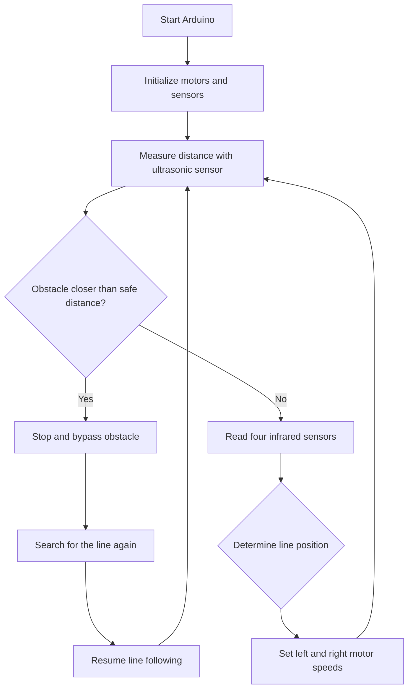

# Arduino Finding Way Car

An Arduino-based autonomous car that follows a line and avoids obstacles detected in front of the vehicle. The project combines infrared line sensors, an ultrasonic distance sensor, and differential motor control to navigate a predefined track.

## Project Purpose

The purpose of this project is to build a small autonomous vehicle capable of:

- Following a black line on the ground.
- Detecting obstacles in front of the car.
- Temporarily leaving the line to bypass an obstacle.
- Finding the line again and continuing the route.
- Demonstrating basic embedded-systems concepts such as sensor input, motor control, and rule-based decision making.

## Technologies Used

- **C++** for Arduino programming.
- **Arduino IDE** for editing, compiling, and uploading the firmware.
- **Arduino-compatible microcontroller** for the control logic.
- **Four infrared line-tracking sensors** for detecting the track.
- **Ultrasonic distance sensor** for forward obstacle detection.
- **Two DC motors** with a motor driver for differential steering.
- **PWM motor control** using `analogWrite()`.
- **Serial communication** at 9600 baud for debugging and monitoring.

## Main Features

### 1. Line Following

The car reads four infrared sensors and adjusts the left and right motor speeds according to the detected line position:

- Move forward when the line is centered.
- Slow one side to make a gentle turn.
- Use a pivot turn when the line is detected at the far left or far right.
- Stop when the sensor state indicates that the car has lost the track or reached a stop condition.

### 2. Obstacle Detection

The ultrasonic sensor measures the distance in front of the car. When an obstacle is closer than the configured safe distance, the car stops and starts the obstacle-bypass routine.

### 3. Obstacle Bypass

The car performs a predefined sequence:

1. Stop briefly.
2. Turn to one side.
3. Move forward around the obstacle.
4. Turn back toward the original route.
5. Move forward until the line sensors detect the track again.
6. Make a small correction and resume line following.

### 4. Adjustable Motion Parameters

The following values can be tuned in the Arduino sketch:

- Base forward speed.
- Turning speed.
- Pivot-turn speed.
- Safe obstacle distance.
- Obstacle-bypass timing.

## Hardware Connections

The current `BigMapOK.ino` implementation uses the following pin assignments:

| Component | Arduino Pin |
|---|---:|
| Left motor forward | D6 |
| Left motor reverse | D5 |
| Right motor forward | D10 |
| Right motor reverse | D11 |
| Left-most IR sensor | A0 |
| Left IR sensor | A2 |
| Right IR sensor | A4 |
| Right-most IR sensor | A5 |
| Ultrasonic TRIG | D3 |
| Ultrasonic ECHO | D2 |

> Check your actual wiring and motor-driver board before powering the car. Pin assignments may need to be changed for different hardware.

## Installation and Execution

### Requirements

- Arduino-compatible board.
- Arduino IDE.
- Four infrared line sensors.
- Ultrasonic distance sensor.
- Two DC motors and a compatible motor driver.
- Battery or external power supply suitable for the motors and controller.
- A track with a visible line and enough space for obstacle bypassing.

### Steps

1. Clone or download this repository.
2. Open `BigMapOK.ino` in the Arduino IDE.
3. Connect the Arduino board to your computer with a USB cable.
4. Select the correct board under **Tools > Board**.
5. Select the correct serial port under **Tools > Port**.
6. Verify that the sensor and motor wiring matches the pin configuration in the sketch.
7. Upload the sketch to the Arduino board.
8. Place the car on the track.
9. Power the motor driver and Arduino board.
10. Observe the car as it follows the line and reacts to obstacles.

For debugging, open the Serial Monitor at **9600 baud**. The current sketch initializes serial communication, although additional diagnostic messages can be added if needed.

## System Architecture

The system uses a simple sensor-processing-control loop:



### Control Flow Summary

1. Initialize the motor pins, infrared sensors, ultrasonic sensor, and serial communication.
2. Measure the distance to an object in front of the car.
3. If an obstacle is too close, execute the bypass routine.
4. Otherwise, read the infrared sensors.
5. Select forward, turning, pivoting, or stopping behavior.
6. Apply the selected speeds to the two motors.
7. Repeat continuously.

## Demo

This repository currently contains Arduino firmware rather than a separate mobile or web application. The project demo is therefore the physical car running on a line-following track.

Recommended demo scenarios:

- **Basic line following:** Run the car on a track without obstacles.
- **Gentle turns:** Test left and right curves.
- **Obstacle bypass:** Place an object in front of the car and verify that it avoids the object and returns to the line.
- **Recovery behavior:** Test how the car behaves when the line is temporarily lost.

### Demo Media

Add project media to the repository and replace the placeholders below when available:

```text


```

If screenshots or a video are not available, the uploaded Arduino sketch and the physical demonstration can be used as the primary project demo.

## My Responsibilities

My responsibilities in this project included:

- Designing the control logic for the autonomous car.
- Programming the Arduino firmware in C++.
- Integrating the infrared line sensors and ultrasonic distance sensor.
- Implementing differential motor control for forward movement, turning, and pivoting.
- Developing the obstacle-bypass sequence.
- Tuning motor speeds, safe distance, and movement timing through testing.
- Checking the car's behavior on a physical track and adjusting the control rules.

## Known Limitations

- The obstacle-bypass route uses fixed delays, so it may not work reliably for obstacles of different sizes or positions.
- Motor speed and turning time depend on the battery level, motor characteristics, floor surface, and car assembly.
- The car can lose the track if the line is too thin, damaged, highly reflective, or outside the sensor range.
- The current control algorithm is rule-based and does not use PID control.
- The ultrasonic sensor can produce unstable readings in noisy environments or when the obstacle has an angled surface.
- The firmware does not currently include comprehensive error handling for disconnected sensors or motor-driver failures.
- The project does not currently provide a dedicated mobile app or graphical dashboard.

## Future Improvements

- Add PID control for smoother and more stable line following.
- Replace fixed obstacle-bypass delays with feedback-based navigation.
- Add more robust ultrasonic filtering and timeout handling.
- Add calibration routines for the infrared sensors.
- Add battery-voltage monitoring and low-battery protection.
- Add wireless control or telemetry using Bluetooth or Wi-Fi.
- Create a mobile or web dashboard for sensor data and live status.
- Add a recorded demo video and hardware photos.
- Organize shared constants and reusable functions into a clearer project structure.

## Repository Structure

```text
.
├── BigMapOK.ino                         # Main Arduino sketch
└── Arduino/
    ├── BigMapOK/                        # Arduino project version
    ├── 111316034Arduino/                # Additional project version
    ├── Forward_detection_barrier_ver.1/ # Forward obstacle-detection version
    └── Forward_detection_ver_1/         # Earlier detection version
```

## Safety and Privacy

This README and project configuration do not contain API keys, passwords, authentication tokens, or personal information. Keep these items out of source code and repository history when extending the project.

## License

No license has been specified for this repository yet. Add a license file if you want others to reuse, modify, or redistribute the project under defined terms.
